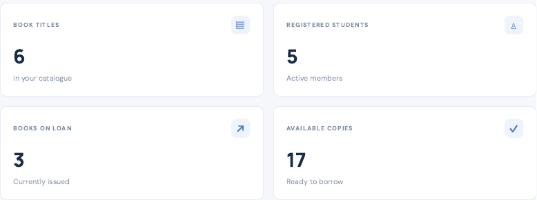
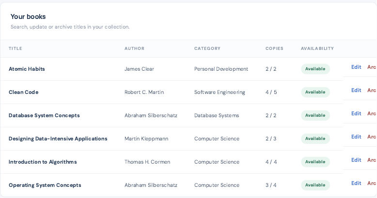
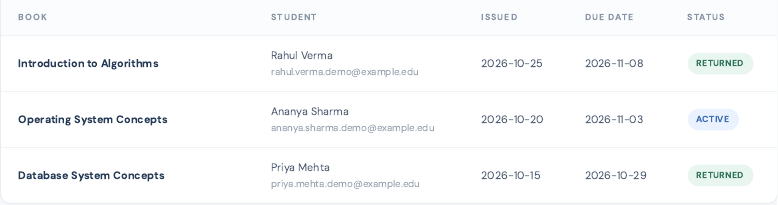
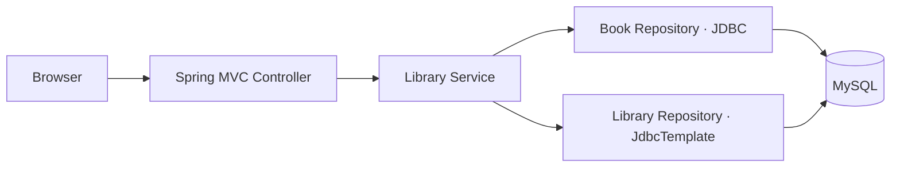
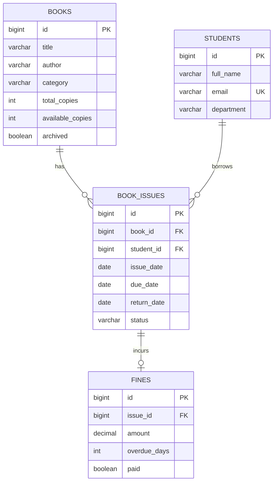

# Library Book Management System

This project handles the day-to-day circulation work of a small library: keeping the catalogue up to date, issuing books to students, recording returns, and tracking overdue fines. It is a server-rendered Java web app built with Spring Boot, Thymeleaf, and MySQL.

## Features

- Live dashboard totals and recent loans
- Book catalogue with search, create, edit and safe archive; issued-copy counts are preserved
- Student registration, editing, search and full borrowing history
- Transactional book issue with a 14-day term, three-loan student limit, and atomic inventory decrement
- Conditional return processing with a calculated ₹5-per-day overdue fine
- Fine register, paid/pending totals and payment recording
- Transaction and fine reports with filtering and print support
- Traditional JDBC in `BookRepository`; Spring `JdbcTemplate` for students, circulation, fines and dashboard queries

## Screenshots

The screenshots below are from the running application.

### Dashboard



### Book catalogue



### Circulation



## Fine example

The loan period is 14 days and the overdue rate is ₹5 per day. For example, if a book is due on 15 October and returned on 18 October, the fine is 3 × ₹5 = ₹15. Returning a book on or before its due date creates no fine.

## Stack and architecture

Java 17, Spring Boot 3, Spring MVC, Thymeleaf, Spring JDBC, MySQL 8 and Maven.



### Data model



`fines.issue_id` is also unique in the MySQL schema, so each issue can have at most one fine.

The schema is initialized with `CREATE TABLE IF NOT EXISTS`; it does not drop or reseed existing data. Books with circulation history are archived rather than deleted, and books with active loans cannot be archived. A unique fine `issue_id` prevents duplicate fines.

## Project structure

```text
src/main/java/edu/library/       Application, MVC controller, models, repositories, service
src/main/resources/templates/    Thymeleaf pages
src/main/resources/static/css/   Responsive interface
src/main/resources/schema.sql    Non-destructive table initialization
src/test/java/                   Unit tests
sql/setup.sql                    Optional database creation command
```

## Setup on macOS (Apple Silicon)

Install Java 17+, Maven 3.9+, and MySQL 8 using Homebrew if needed:

```bash
brew install openjdk@17 maven mysql
brew services start mysql
```

Create `library_db` and a local account (choose your own password):

```bash
mysql -u root -p
```

At the MySQL prompt:

```sql
CREATE DATABASE IF NOT EXISTS library_db CHARACTER SET utf8mb4 COLLATE utf8mb4_0900_ai_ci;
CREATE USER IF NOT EXISTS 'library_app'@'localhost' IDENTIFIED BY 'change-this-password';
GRANT ALL PRIVILEGES ON library_db.* TO 'library_app'@'localhost';
EXIT;
```

Set credentials in your shell (the password is not stored in source):

```bash
export DB_URL='jdbc:mysql://localhost:3306/library_db?useSSL=false&allowPublicKeyRetrieval=true&serverTimezone=UTC'
export DB_USERNAME='library_app'
export DB_PASSWORD='change-this-password'
```

Build and run:

```bash
mvn clean test
mvn spring-boot:run
```

Open <http://localhost:8080>. The application creates the required tables at startup without resetting existing rows.

## JDBC demonstration

`BookRepository` injects the Spring-managed `DataSource`, opens a `Connection`, prepares parameterized SQL, reads results with `ResultSet`, and closes resources with try-with-resources. `LibraryRepository` demonstrates Spring `JdbcTemplate` query and update calls. `LibraryService` contains business rules and `@Transactional` operations. The controller maps browser requests to service methods and Thymeleaf templates.

## Fine rule

Due date is issue date + 14 days. At return, overdue days are `max(0, return date - due date)`, and the amount is overdue days × ₹5, stored as `DECIMAL(10,2)`. The fine record is created within the same transaction as the return and inventory update.

## Tests

`mvn clean test` runs isolated JUnit tests for fine calculation and never connects to the production database. Issue/return integration tests require a configured test MySQL instance and should be run after adding a dedicated test profile/database.
